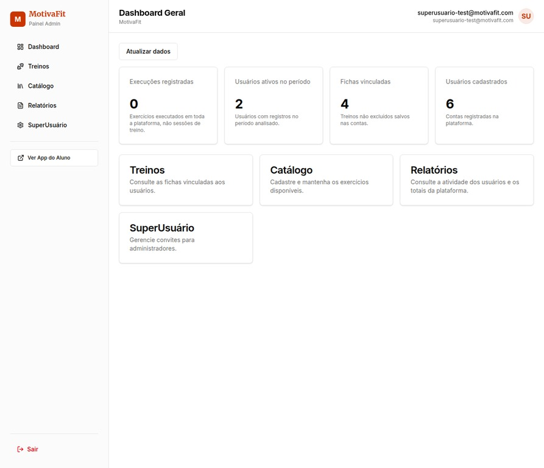
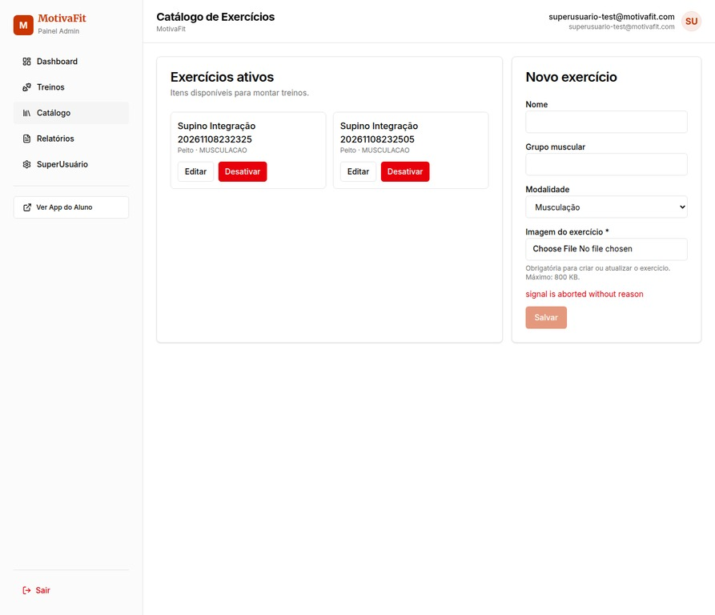
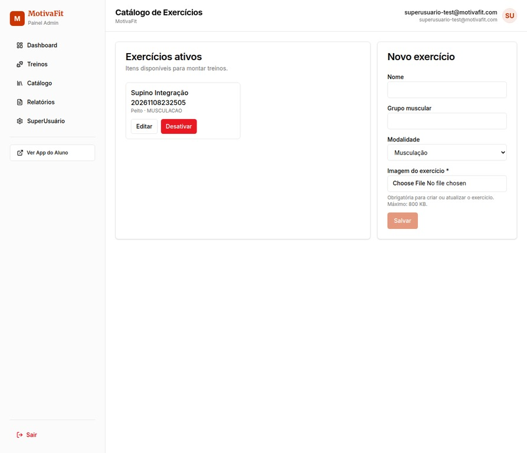
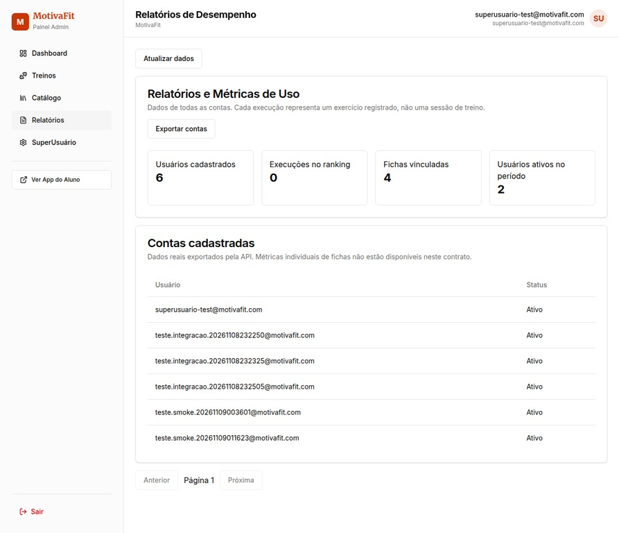
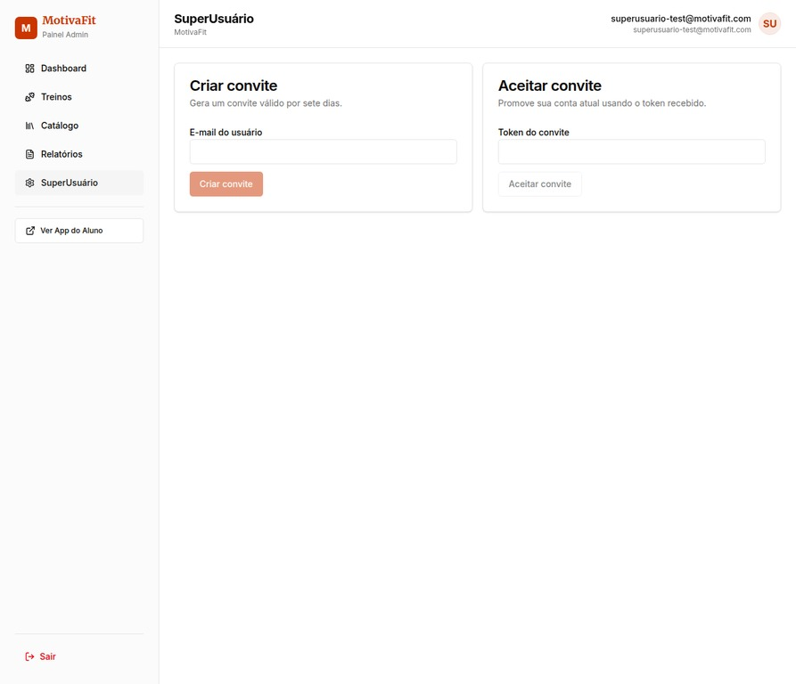
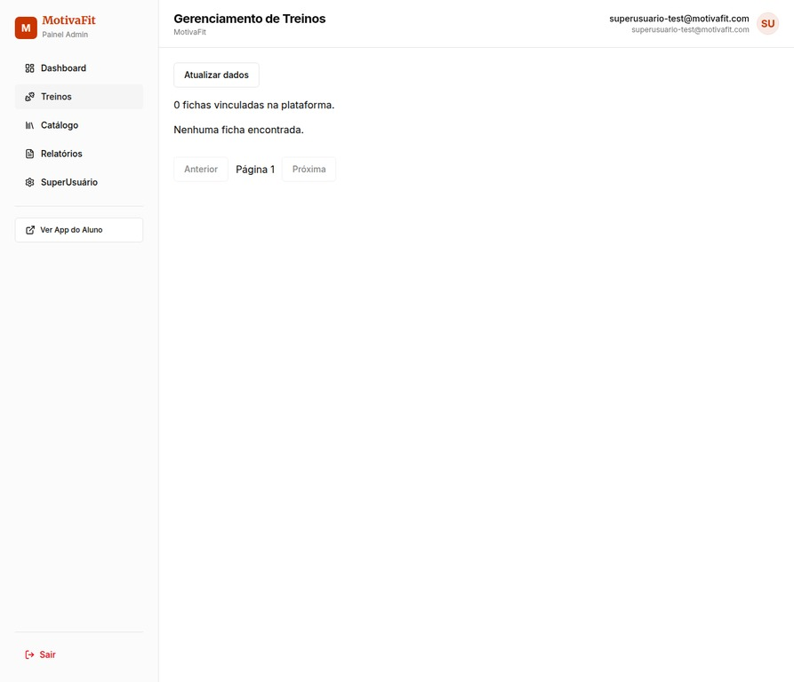

# Relatório de testes de integração — MotivaFit

**Data:** 19/11/2026  
**Escopo:** integração do frontend React/Vite com o backend Spring Boot e validação visual/funcional do Painel Admin.  
**Ambiente:** sandbox Linux, PostgreSQL local, backend na porta `8080` e frontend Vite na porta `3000`.  
**Usuário de teste:** superusuário criado para homologação; a senha e os tokens não são registrados neste documento.

!!! note "Atualizado em 23/11/2026"
    As seções 1 a 8 registram o teste de 19/11/2026 e foram mantidas como evidência. Desde então, o Painel Admin passou a exibir **apenas métricas gerais**: Dashboard, Relatórios e Treinos não mostram mais contas, e-mails nem treinos individuais, e a rota de exportação de contas foi removida. As capturas das seções 2.1, 2.3 e 2.5 mostram a versão anterior. O comportamento atual e os novos casos estão na [seção 9](#9-atualizacao-de-23112026-painel-com-metricas-gerais).

## 1. Resumo executivo

A integração foi validada com sucesso pelo fluxo real do navegador: o frontend exibiu a tela de login, enviou as credenciais ao backend, recebeu o JWT e redirecionou para `/admin`. A partir do painel, as rotas administrativas carregaram dados provenientes da API e uma operação de catálogo foi executada com sucesso.

Durante a primeira tentativa, a interface mostrou “O servidor retornou uma resposta inválida”. A investigação isolou a causa em CORS: o navegador acessa o frontend pelo domínio HTTPS encaminhado do sandbox, enquanto o backend aceitava apenas a origem local `http://localhost:3000`. Após iniciar o backend de homologação aceitando a origem HTTPS do navegador, o login funcionou sem alteração no contrato da API.

## 2. Evidências visuais

### 2.1 Dashboard após login administrativo

O login foi aprovado e o usuário foi direcionado para `/admin`. O dashboard apresentou métricas retornadas pelo backend: execuções registradas, usuários ativos, fichas vinculadas e usuários cadastrados.

### 2.2 Catálogo de exercícios

A tela `/admin/catalogo` carregou exercícios persistidos no backend e exibiu os controles `Editar` e `Desativar`. O caso de desativação foi executado sobre um exercício de integração; após a ação, o item deixou de aparecer na lista de exercícios ativos.

### 2.3 Relatórios

A tela `/admin/relatorios` carregou as métricas e a relação de contas cadastradas pela API (comportamento substituído em 23/11/2026; ver seção 9). Foram exibidos seis usuários ativos no banco de teste, além dos totais de execuções e fichas.

### 2.4 SuperUsuário

A tela `/admin/superusuario` foi acessada com autorização de superusuário e exibiu as operações de criação e aceitação de convite.

### 2.5 Gerenciamento de treinos

A tela `/admin/treinos` foi carregada e consultou a API (na época, listava fichas; hoje mostra apenas totais, ver seção 9). Neste estado do banco de homologação não havia fichas vinculadas para listar; a mensagem “Nenhuma ficha encontrada” foi apresentada corretamente.

## 3. Casos executados

| ID | Caso | Procedimento | Resultado | Situação |
|---|---|---|---|---|
| INT-01 | Disponibilidade do backend | Consultar `GET /v3/api-docs` | HTTP 200 | Aprovado |
| INT-02 | CORS da origem do navegador | Enviar preflight OPTIONS com a origem HTTPS do frontend | HTTP 200, `Access-Control-Allow-Origin` correto e credenciais permitidas | Aprovado após ajuste de ambiente |
| INT-03 | Login pela interface | Preencher e-mail/senha e clicar em “Entrar na conta” | JWT recebido e redirecionamento para `/admin` | Aprovado |
| INT-04 | Proteção do painel | Acessar rotas admin com perfil `SUPERUSUARIO` | Dashboard e menu administrativo disponíveis | Aprovado |
| INT-05 | Dashboard | Carregar `/admin` | Métricas retornadas e renderizadas | Aprovado |
| INT-06 | Catálogo | Carregar `/admin/catalogo` | Exercícios do backend renderizados | Aprovado |
| INT-07 | Desativar exercício | Clicar em `Desativar` em exercício de teste | Item removido da lista de ativos após atualização | Aprovado |
| INT-08 | Relatórios | Carregar `/admin/relatorios` | Métricas e contas cadastradas renderizadas | Aprovado |
| INT-09 | SuperUsuário | Carregar `/admin/superusuario` | Formulários de convite renderizados para o perfil autorizado | Aprovado |
| INT-10 | Treinos administrativos | Carregar `/admin/treinos` | Consulta concluída e estado vazio tratado sem quebra | Aprovado |

## 4. Resultado técnico da autenticação

O backend retornou um objeto JSON contendo `token` e `expirationAt`. O frontend decodificou as claims do JWT e validou os campos necessários (`sub`, `id`, `ativo`, `perfil`, `iat` e `exp`). O perfil recebido foi `SUPERUSUARIO`, permitindo acesso a todas as rotas administrativas.

A implementação relevante está em `frontend/MotivaFit/src/lib/api/auth-api.ts` e `frontend/MotivaFit/src/lib/auth-context.tsx`. A camada de autenticação não depende de identidade armazenada em `localStorage`; a sessão é mantida pelo token em memória e pelos cookies de refresh/CSRF.

## 5. Achados e correções de ambiente

### 5.1 CORS no domínio encaminhado

A primeira tentativa do navegador resultou em HTTP 403 com o texto `Invalid CORS request`. A mesma requisição feita localmente com `curl` retornava HTTP 200, o que demonstrou que o contrato de login estava correto. A diferença era a origem: o navegador utilizava o domínio HTTPS do sandbox.

Para a execução de homologação, o backend foi iniciado com a origem do frontend encaminhado. Em ambiente local no computador do grupo, a configuração equivalente deve aceitar a origem que realmente será usada, normalmente `http://localhost:3000`, sem liberar origens genéricas em produção.

### 5.2 Mensagem `signal is aborted without reason` no formulário de catálogo

A tela de catálogo exibiu essa mensagem junto ao formulário de criação, embora a listagem e a desativação tenham funcionado. O formulário exige uma imagem antes de criar ou atualizar um exercício. Como o caso executado foi a desativação de um exercício existente, não foi classificado como falha da integração principal, mas recomenda-se abrir uma tarefa para revisar o tratamento de abort/cancelamento da requisição de upload e exibir uma mensagem mais compreensível ao usuário.

### 5.3 Marcadores de conflito

Foi executada uma busca por `<<<<<<<`, `=======` e `>>>>>>>` em `frontend/MotivaFit/src`; nenhum marcador foi encontrado no checkout utilizado para este teste.

## 6. Classificação dos testes

Os casos INT-01 e INT-02 são testes de integração da API com o ambiente de execução. Os casos INT-03 a INT-10 são testes de integração frontend–backend e também possuem caráter de teste de sistema, pois percorrem o produto pela interface e verificam um fluxo administrativo completo.

Os testes de API registrados anteriormente continuam complementares: cobrem cadastro, validações, login, JWT, autorização e CRUD de treinos diretamente pela API. Este relatório acrescenta a evidência que faltava: a requisição sendo disparada pela interface e a resposta sendo refletida nas telas do painel.

## 7. Como reproduzir

1. Iniciar o PostgreSQL e configurar o banco de teste conforme o README do projeto.
2. Iniciar o backend na porta `8080`.
3. Iniciar o frontend na porta `3000`.
4. Abrir a URL do frontend e acessar `/login`.
5. Usar uma conta de superusuário de homologação.
6. Confirmar o redirecionamento para `/admin`.
7. Percorrer Dashboard, Treinos, Catálogo, Relatórios e SuperUsuário.
8. No Catálogo, usar um exercício descartável para validar `Desativar`.
9. Para um ambiente encaminhado por HTTPS, configurar CORS com a origem HTTPS efetiva do frontend. Para execução local, usar a origem local efetiva.

Não publicar no GitHub senhas, JWTs, cookies `refreshToken`/`csrfToken`, dumps do banco ou arquivos `.env` com credenciais.

## 8. Conclusão

A comunicação frontend–backend e o acesso ao Painel Admin foram comprovados. O login administrativo, a autorização por perfil, o carregamento de dados do dashboard, catálogo, relatórios, superusuário e treinos, além da desativação de exercício, funcionaram no ambiente de teste. O único bloqueio encontrado foi a configuração de CORS específica do domínio encaminhado; depois de corrigida no ambiente, o fluxo foi aprovado.

## 9. Atualização de 23/11/2026: painel com métricas gerais

### 9.1 O que mudou

O Painel Admin deixou de exibir dados associados a pessoas e passou a mostrar somente valores agregados, vindos das rotas `/api/admin/metricas/*`.

| Tela | Antes (19/11/2026) | Agora |
| :-- | :-- | :-- |
| Dashboard (`/admin`) | Totais calculados a partir da lista completa de contas | Contas cadastradas, usuários ativos no período, treinos ativos e execuções dos exercícios mais realizados, sem consultar contas |
| Relatórios (`/admin/relatorios`) | Métricas e tabela de contas (e-mail, perfil e status), com exportação de contas em CSV | Indicadores gerais, exercícios mais realizados e exportação CSV apenas com indicadores agregados |
| Treinos (`/admin/treinos`) | Lista de fichas | Treinos ativos, treinos por tipo, percentuais de treinos públicos e de registros com treino e treinos públicos mais adicionados |
| Métricas (`/admin/metricas`, nova) | Não existia | Por período: usuários ativos com série, frequência média, tempo total, média e mediana por usuário ativo, exercícios mais realizados, rotinas e retenção por coorte semanal |
| SuperUsuário (`/admin/superusuario`) | Criação e aceite de convite | Somente criação. O aceite passou para "Minha conta", porque quem recebe o convite ainda não é superusuário |

No back-end, a rota `GET /api/conta/exportacao` foi removida. Exercícios praticados por menos de cinco pessoas continuam omitidos do ranking, e o ranking de tempo por posição não é exibido no painel.

### 9.2 Correções no back-end que afetam os números do painel

- O percentual de treinos públicos, a mediana de frequência e os totais de tempo vinham zerados ou nulos. A leitura de consultas de linha única foi corrigida.
- "Treinos públicos mais adicionados" sempre vinha vazio, porque procurava cópias públicas, e toda cópia é privada. Agora conta as cópias por treino de origem.
- Média e mediana de tempo "por usuário ativo" eram ponderadas pelo número de registros. Agora são calculadas com um valor por usuário.
- `suprimidos` (exercícios omitidos por privacidade) passou a ser calculado.
- A série de usuários ativos, a retenção por coorte e o percentual de registros com treino deixaram de retornar valores fixos.

### 9.3 Casos executados

| ID | Caso | Procedimento | Resultado | Situação |
|---|---|---|---|---|
| INT-11 | Painel sem dados individuais | Testes de interface de Dashboard, Relatórios e Treinos (`tests/admin-api.test.tsx`) | Apenas rotas `/api/admin/metricas/*` são chamadas; nenhuma célula de tabela exibe e-mail | Aprovado |
| INT-12 | Exportação agregada | Gerar o CSV do relatório | Somente pares indicador/valor, sem e-mails | Aprovado |
| INT-13 | Rota de exportação removida | `GET /api/conta/exportacao` como superusuário | Sem rota própria; recusado como id inválido (400) | Aprovado |
| INT-14 | Contrato front-back real | Back-end com PostgreSQL real; módulos de API do front chamando conta, tema, amizade, desafios, grupos, cópia de treino, evolução, métricas e convite de administrador | Todas as respostas aceitas pelos validadores do front | Aprovado |
| INT-15 | Chave JWT inválida | Iniciar o back-end com `JWT_SECRET` que não decodifica para 32 bytes | A aplicação não inicia e informa como gerar a chave | Aprovado |

Suítes automatizadas na mesma data: 80 testes de interface do front-end e 336 testes do back-end, todos aprovados.

### 9.4 Pendente

Refazer as capturas das seções 2.1, 2.3 e 2.5 no navegador com a versão atual do painel.

